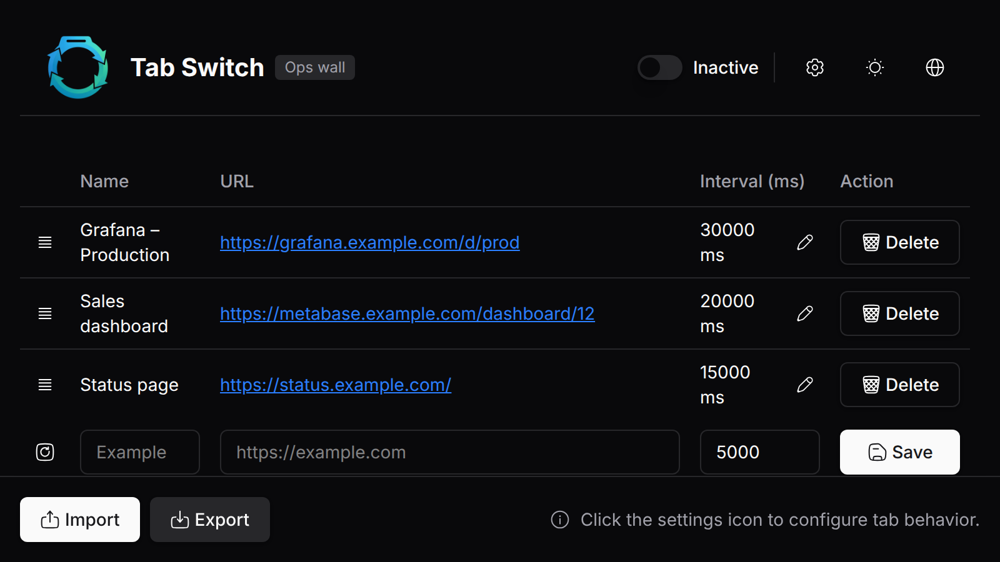

<div align="center">
  
  <h1>Tab Switch</h1>
  <p>A Chrome extension that rotates through a list of pages automatically. Built for wall displays, monitoring dashboards and presentations.</p>

  [](https://github.com/raniellimontagna/tab-switch/actions/workflows/ci.yml)
  [](https://github.com/raniellimontagna/tab-switch/releases)
  [](LICENSE)
</div>



Tab Switch is not published on the Chrome Web Store. Build it from source and load it as an unpacked extension (see [Installation](#installation)).

## Features

- **Timed rotation:** add pages with a name, URL and interval (5 seconds minimum) and the extension cycles through them in order.
- **Start, pause and resume** from the popup switch or with `Ctrl+Space` while the popup is open; desktop notifications confirm each change.
- **Tab behavior:** keep your existing tabs open, or close every tab that is not part of the rotation.
- **Sessions:** save several named lists (for example "Work" and "Entertainment") and switch between them.
- **Editing:** edit or delete entries, drag to reorder, preview a URL before saving, and leave the name empty to have one generated from the URL.
- **Import and export:** move a configuration as JSON by picking a file, dropping it on the popup or pasting its content. The legacy `tab-rotate` format is accepted too.
- **Safety checks:** URLs are validated before a tab opens, inputs are sanitized, imports are checked for integrity, and tab creation and imports are rate limited.
- **Light and dark themes**, and an interface in English or Portuguese: it follows the browser language and can be switched in the popup.

## Installation

Prerequisites: Node.js 22 or newer and [pnpm](https://pnpm.io) 11.

```bash
git clone https://github.com/raniellimontagna/tab-switch.git
cd tab-switch
pnpm install
pnpm build
```

Then load it in Chrome:

1. Open `chrome://extensions/`.
2. Turn on **Developer mode** (top right).
3. Click **Load unpacked** and select the `build/` folder.

After pulling new changes, run `pnpm build` again and click the reload icon on the extension card.

## Tech stack

- React 19, TypeScript and Vite, as a Manifest V3 extension with a background service worker.
- Tailwind CSS v4 with Radix UI primitives, dnd-kit for drag and drop, React Hook Form and Zod for validation.
- i18next for translations (`public/locales/en` and `public/locales/pt`).
- Vitest and Testing Library for tests, Biome for linting and formatting, Lefthook for git hooks, release-please for versioning.

## Scripts

| Script | What it does |
| --- | --- |
| `pnpm dev` | Start the Vite dev server (the extension itself still needs `pnpm build`) |
| `pnpm build` | Validate the manifest, type-check and build into `build/` |
| `pnpm build:dev` | Unminified development build |
| `pnpm check` / `pnpm check:fix` | Biome lint and format check, with or without fixes |
| `pnpm lint` / `pnpm format` | Biome lint only / format only |
| `pnpm test` | Run the unit tests (Vitest) |
| `pnpm test:watch` / `pnpm test:ui` | Tests in watch mode / in the Vitest UI |
| `pnpm test:coverage` | Tests with a coverage report |
| `pnpm validate:translations` | Check that every translation key exists in all languages |
| `pnpm validate:manifest` | Validate `public/manifest.json` |

To keep verbose logs in a production build, build with `VITE_DEBUG=true pnpm build`.

## Project structure

```text
src/
  background/   service worker: rotation, tab management and messaging
  containers/   the popup screen (home)
  components/   UI components, session manager, tab behavior settings
  hooks/        rotation control, sessions, import and export, shortcuts, theme
  libs/         storage, migrations, i18n, logger, rotation helpers
  utils/        Chrome API wrappers, URL security, sanitizing, rate limiting
public/
  locales/      translations (en, pt)
  manifest.json extension manifest (Manifest V3)
scripts/        manifest and translation validators
docs/API.md     internal messages and storage format
```

## Contributing

Contributions are welcome. Read [CONTRIBUTING.md](CONTRIBUTING.md) for the code conventions, the development workflow, debugging tips and how releases work.

## License

Released under the [MIT License](LICENSE).
